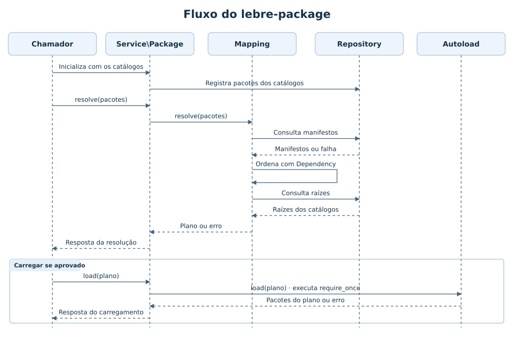
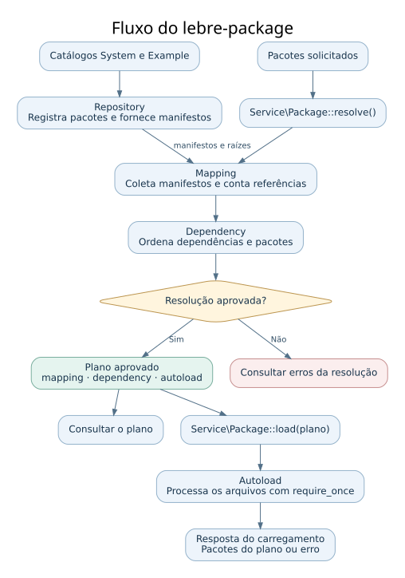

# 0002 — lebre-package

| Item | Valor |
|---|---|
| Estado | Testado e homologado em 2026-11-11 |
| PHP mínimo | 8.2 |
| Namespace do pacote | `Lebre\Package` |
| Serviço | `Service\Package` |
| Manifesto | `repository/package/lebre/package/manifest.php` |
| Dependência direta | `lebre-base` |

## Responsabilidade

O pacote reúne os registros de um ou mais catálogos, consulta os manifestos dos pacotes solicitados e monta um plano de carregamento. O chamador pode inspecionar o plano e decidir quando executar os arquivos de autoload.

## Componentes

| Componente | Responsabilidade |
|---|---|
| `CatalogInterface` | Define o acesso à raiz de instalação e ao mapa de identificadores de pacotes para caminhos relativos de manifestos. |
| `Repository\Package\Catalog\System` | Registra os pacotes fundamentais do LEBRE no catálogo de sistema. |
| `Repository` | Reúne os registros dos catálogos, rejeita identificadores duplicados e carrega manifestos PHP sob demanda. Mantém em cache os manifestos que retornam um array. |
| `Dependency` | Ordena os pacotes por busca em profundidade. Cada dependência precede os pacotes que a declaram e aparece uma única vez na ordem resultante. |
| `Mapping` | Reúne os manifestos, conta as referências e monta o plano de carregamento. |
| `Autoload` | Executa os arquivos do plano com `require_once` e mantém o registro de pacotes carregados na instância. |
| `Code` | Centraliza os códigos de erro com constantes `PACKAGE_*` e valores com prefixo `package-`. |
| `Service\Package` | Recebe múltiplos catálogos e expõe `resolve()` para montar o plano e `load()` para executá-lo. |

## Plano de carregamento

| Chave | Conteúdo |
|---|---|
| `mapping` | Contagem de visitas por identificador. Inclui pedidos diretos e visitas durante a coleta de dependências. |
| `dependency` | Lista de identificadores na ordem de carregamento, incluindo os pacotes solicitados. |
| `autoload` | Lista de caminhos em ordem de carregamento. Cada caminho combina a raiz do catálogo do pacote com o caminho relativo declarado no manifesto. Caminhos textualmente iguais aparecem apenas na primeira ocorrência. |

`resolve()` pode executar os manifestos PHP para obter os arrays de configuração. `load()` recebe o conteúdo da resposta aprovada e executa os arquivos declarados em `autoload`. O retorno de `load()` contém os identificadores do plano atual. O histórico de carregamento pertence à instância usada pelo serviço.

### Sequência de chamadas

O diagrama mostra como o serviço consulta os manifestos, monta o plano
e delega o carregamento ao Autoload quando solicitado.



## Exemplo de uso

Com as classes já carregadas pelo bootstrap, o catálogo de sistema fornece `lebre-package` e o catálogo de exemplo fornece `lebre-example`.

```php
$service = new \Service\Package(
    new \Lebre\Package\Catalog\System(),
    new \Lebre\Package\Catalog\Example()
);

$resolved = $service->resolve('lebre-package', 'lebre-example');

if (!$resolved->isApproved()) {
    var_dump($resolved->getErrors());
    return;
}

$plan = $resolved->getContent();

var_dump($plan['mapping']);
var_dump($plan['dependency']);
var_dump($plan['autoload']);

// Execute esta etapa quando quiser carregar os arquivos do plano.
$loaded = $service->load($plan);

if (!$loaded->isApproved()) {
    var_dump($loaded->getErrors());
    return;
}

var_dump($loaded->getContent());
```

Nesse exemplo, os dois pacotes solicitados dependem de `lebre-base`. Ele é contado duas vezes em `mapping` e aparece uma única vez em `dependency`, antes de `lebre-package` e `lebre-example`.

## Fluxo de carregamento

O plano aprovado pode ser consultado ou executado pelo serviço.



## Integração com lebre-base

O manifesto declara `lebre-base` em `dependency`. Seus arquivos de autoload precedem os de `lebre-package`, que usa `Lebre\Response\Response` e `Lebre\Response\Error`. Atualizações compatíveis com esses contratos são incorporadas na próxima execução do PHP. Mudanças incompatíveis exigem revisão e teste da integração.

No manifesto apresentado, `src/package/code.php` é carregado explicitamente pelo bootstrap do exemplo. Esse arquivo precisa estar disponível antes de qualquer fluxo que consulte as constantes de `Code`.

## Comportamento em caso de falha

- `Dependency::resolve()` identifica ciclos ao ordenar os manifestos já coletados. A coleta recursiva de `Mapping` antecede essa etapa. Na implementação apresentada, um ciclo pode impedir que a coleta chegue à ordenação.
- Uma falha de autoload mantém os efeitos dos arquivos já incluídos. Os novos pacotes só entram no registro da instância após o processamento de todo o plano.

## Exemplo de manifesto e catálogo

O catálogo associa o identificador `lebre-example` ao caminho relativo do seu manifesto. O manifesto declara a dependência de `lebre-base` e deixa a lista de autoload vazia.

### Manifesto de `lebre-example`

Arquivo `repository/package/lebre/example/manifest.php`

```php
<?php

declare(strict_types=1);

/**
 * Declara lebre-base como dependência de lebre-example.
 *
 * A lista de autoload está vazia. O plano inclui os arquivos
 * declarados no manifesto de lebre-base.
 */

return [
    'dependency' => ['lebre-base'],
    'autoload' => [],
];
```

### Catálogo `Example`

Arquivo `repository/package/catalog/example.php`

```php
<?php

declare(strict_types=1);

namespace Repository\Package\Catalog;

use Lebre\Package\CatalogInterface;

/**
 * Fornece a localização do manifesto do pacote lebre-example.
 */
final class Example implements CatalogInterface
{
    /**
     * Retorna a raiz de instalação usada por este catálogo.
     *
     * @return string Caminho absoluto com separador final.
     */
    public function getRoot(): string
    {
        return '/user/LEBRE_026/';
    }

    /**
     * Retorna os caminhos dos manifestos relativos a getRoot().
     *
     * @return array<string, string> Identificadores de pacotes e seus caminhos.
     */
    public function getPackages(): array
    {
        return [
            'lebre-example' => 'repository/package/lebre/example/manifest.php',
        ];
    }
}
```

### Uso com o catálogo de sistema

O catálogo `System` fornece `lebre-base`. O serviço reúne os dois catálogos para resolver `lebre-example` e sua dependência.

```php
$service = new \Service\Package(
    new \Lebre\Package\Catalog\System(),
    new \Lebre\Package\Catalog\Example()
);

$resolved = $service->resolve('lebre-example');

if ($resolved->isApproved()) {
    $plan = $resolved->getContent();
    var_dump($plan['dependency']); // ['lebre-base', 'lebre-example']
}
```
